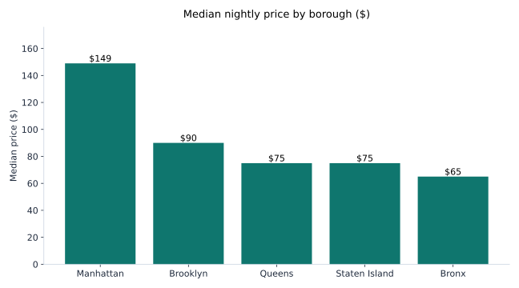
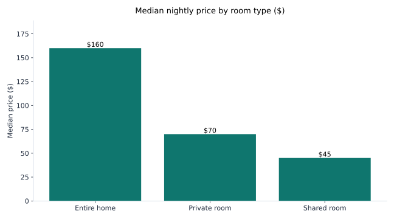

# NYC Airbnb Pricing Analysis

I live next to New York City. I wanted to know what sets the price of a night here. So I took the city's public Airbnb listing data and worked through it myself, in Python and SQL.

I am a Data Analyst. I spent 3 years at JEEVIKA in Bihar, India, working with program data. Now I have an M.S. in Information Systems from Rider University, and I live in Jersey City, NJ. This is my city too, so I wanted the numbers to be real.

## What I found

- **Prices are skewed.** The mean price is about $152.70. The median is $106. The standard deviation is about $240, bigger than the mean. A few very expensive listings pull the average up. The median is the honest number for a typical night.
- **Two boroughs run the market.** Manhattan has 21,306 listings (44.0%). Brooklyn has 19,986 (41.3%). Together that is 85.3% of all listings. Queens has 11.7%, the Bronx 2.2%, Staten Island 0.8%.
- **Location sets the price.** Median nightly price: Manhattan $149, Brooklyn $90, Queens $75, Staten Island $75, Bronx $65. A typical Manhattan listing costs about 2.3x a Bronx one. That gap is the story.

- **Room type sets the price too.** Median nightly price: entire home $160, private room $70, shared room $45. An entire home costs about 2.3x a private room and 3.6x a shared room.

- **A third of the market is professionals, not spare rooms.** Hosts with more than one listing own 16,443 listings. That is 34.0% of the market. The biggest are Sonder (NYC) with 272 listings, Blueground with 180, and Kazuya with 103.
- **Cleaning matters.** I dropped 499 rows (1.0%) for zero or empty prices. That left 48,396 clean listings.

## What I would tell a host

1. **Price by borough first, then by room type.** The median listing in Manhattan ($149) costs more than twice the median in the Bronx ($65).
2. **Use the median, not the mean.** The mean ($152.70) is pulled up by a few luxury listings. The median ($106) is what a typical guest pays.
3. **Reviews show demand, not bookings.** A listing with many reviews per month is in demand. But this data cannot say how many nights it was actually booked.

## The data

- **Source:** NYC Airbnb Open Data, Kaggle: https://www.kaggle.com/datasets/dgomonov/new-york-city-airbnb-open-data
- **File:** `AB_NYC_2019.csv` (download it into `data/`, see [data/DATA_SOURCE.md](data/DATA_SOURCE.md))
- **Size:** 48,895 listings, 16 columns, one row per listing.
- **Columns:** host_id, host_name, calculated_host_listings_count, neighbourhood_group, neighbourhood, latitude, longitude, room_type, price, minimum_nights, availability_365, number_of_reviews, last_review, reviews_per_month.

Read this before using the numbers. This is a 2019 snapshot. There is no seasonality in it. Prices are a single point in time, not a trend over the year. And `reviews_per_month` is a proxy for demand, not actual bookings.

## How to run it

1. Download `AB_NYC_2019.csv` into `data/` (see [data/DATA_SOURCE.md](data/DATA_SOURCE.md)).
2. `pip install -r requirements.txt`
3. Open `notebooks/01-airbnb-pricing-analysis.ipynb` and run it top to bottom.
4. The SQL in `sql/airbnb_queries.sql` answers the same questions in SQLite.

## Limits of this work

- 2019 snapshot: no seasonality, no trend over time, and prices today are different.
- `reviews_per_month` is a proxy for demand, not bookings or occupancy.
- Prices of $0 in the raw file are bad data, not free listings. I removed them in cleaning.
- This is public listing data, not Airbnb's own records. It shows what hosts ask for, not what guests pay after fees.

## Tools

Python (pandas, matplotlib), SQL (SQLite), Jupyter.
